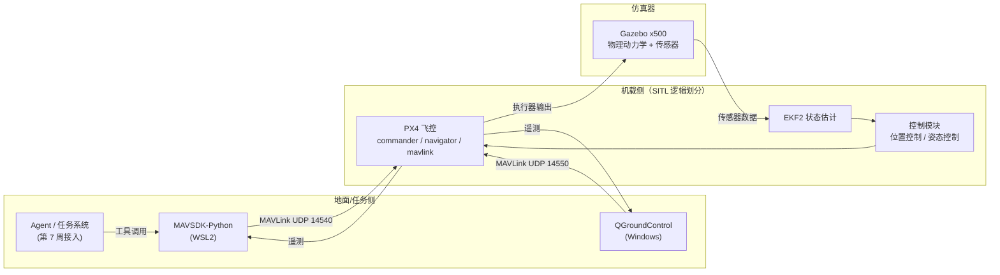

# Week 01 系统链路图

## 一句话版本

无人机系统不是一个“大程序”，而是分工明确的几层：

> 飞控负责稳定飞行和安全；机载/任务侧负责高层任务；数据链负责传消息；地面站负责监控和人工操作；云/任务系统负责调度和数据。

Agent 不直接控制电机，它只把高层任务交给飞控执行。

## 总体链路



文字版：

```text
+---------------------- 地面 / 任务侧 -----------------------+
|  Agent / 任务系统  ->  MAVSDK-Python   QGroundControl       |
+------------------------------+-----------------------------+
                               | MAVLink over UDP
                               | 14540（MAVSDK） / 14550（QGC）
+------------------------------v-----------------------------+
|                     PX4 飞控（SITL）                        |
|  mavlink -> commander / navigator -> 控制模块 -> 执行器     |
|                 EKF2 状态估计 <- 传感器                     |
+------------------------------+-----------------------------+
                               | gz_bridge
+------------------------------v-----------------------------+
|                     Gazebo x500 仿真                        |
|                  物理动力学 + 传感器模型                    |
+-------------------------------------------------------------+
```

## 五个组成部分

| 组件 | 职责 | 当前 SITL 中的对应物 | 真机中的对应物 |
|---|---|---|---|
| 飞控 | 姿态/位置控制、解锁、模式、任务、失效保护 | PX4 v1.16.2（WSL2） | Pixhawk 等飞控板 + PX4 |
| 机载/任务计算机 | 运行高层任务、Agent、视觉、通信 | WSL2 里的 Python/MAVSDK 进程（逻辑角色） | Jetson / RK3588 等伴飞计算机 |
| 数据链 | 传输 MAVLink 命令和遥测 | WSL2 mirrored 网络的 UDP | 数传电台、4G/5G、卫星链路 |
| 地面站 | 人工监控、参数、任务规划、日志 | QGC 4.4.5.0（Windows） | QGC / 自研地面站 |
| 云/任务系统 | 任务调度、机队管理、数据存储、展示 | 阶段 2 实现 | 低空经济云平台 |

### 必须理解的边界

- **飞控是安全关键层**：即使地面站、Agent、数据链全部失联，PX4 仍能按 `NAV_DLL_ACT` 执行 Hold / RTL / Land。
- **Agent 不是安全层**：Agent 只输出高层任务（起飞、航线、返航），不输出姿态、速度、电机控制量。
- **地面站不是飞行的必要条件**：QGC 断开只影响人工监控，不影响飞控自身的稳定控制和失效保护。
- **SITL 中的“机载计算机”是逻辑划分**：当前 Python/MAVSDK 跑在 WSL2 主机上；真机中它会在飞机上的伴飞计算机里，通过串口或以太网连飞控。

## 三条消息流

### 流 1：上行命令流（谁让飞机做事）

```text
Agent / QGC
   ↓  MAVSDK API 或 QGC 操作
MAVLink 命令
   ↓  UDP 14540（MAVSDK） / 14550（QGC）
PX4 mavlink 模块
   ↓
commander（解锁、模式、失效保护）
   ↓
navigator（任务、RTL、降落）
   ↓
控制模块（位置/姿态/电机输出）
```

典型消息：

- `COMMAND_LONG`（76）：通用命令，如解锁、起飞、切换模式
- `COMMAND_ACK`（77）：飞控对命令的确认或拒绝
- `MISSION_COUNT` / `MISSION_REQUEST_INT` / `MISSION_ITEM_INT` / `MISSION_ACK`：航线任务上传
- `SET_MODE`：切换飞行模式

特点：**事件驱动**。只有下发命令时才会出现，不会一直周期发送。

### 流 2：下行遥测流（飞机告诉外界发生了什么）

```text
PX4 传感器 / EKF2
   ↓
mavlink 模块按配置的速率发送
   ↓  UDP 14540 / 14550
MAVSDK / QGC
   ↓
Agent 或人看到状态
```

典型消息：

- `HEARTBEAT`（0）：心跳，链路存活
- `SYS_STATUS`（1）：系统状态和传感器健康，电量也在里面
- `ATTITUDE`（30）：姿态角
- `LOCAL_POSITION_NED`（32）：局部位置/速度
- `GLOBAL_POSITION_INT`（33）：经纬度、海拔、相对高度

特点：**周期消息**。按设定频率持续发送；断开后飞控会触发失效保护。

### 流 3：机载闭环控制流（飞控如何让飞机稳定）

```text
目标位置/姿态
   ↓
PX4 控制模块（位置控制、姿态控制）
   ↓
执行器输出（电机/舵机）
   ↓  gz_bridge（SITL）
Gazebo x500 物理引擎
   ↓
模拟传感器（IMU、GPS、气压计、磁力计）
   ↓
PX4 EKF2 状态估计
   ↓
控制模块
```

特点：

- 这是**机载实时闭环**，通常不经过 MAVLink，也不经过地面站
- SITL 中用 `gz_bridge` 把 PX4 执行器输出送进 Gazebo，再把传感器数据送回 PX4
- 真机中就是飞控板接电调、电机、IMU、GPS 等

## 端口与地址

| 用途 | 当前配置 | 说明 |
|---|---|---|
| MAVSDK | `udp://:14540` | PX4 的 Onboard MAVLink 实例发往 14540 |
| QGC | UDP 14550 | PX4 的 Normal MAVLink 实例发往 14550 |
| Gazebo | `gz_bridge` | 不是 MAVLink，是 PX4 与仿真器之间的进程间通信 |

PX4 SITL 启动日志里能看到多个 MAVLink 实例，例如：

```text
Normal   udp port 18570 remote port 14550
Onboard  udp port 14580 remote port 14540
Onboard  udp port 14280 remote port 14030
Gimbal   udp port 13030 remote port 13280
```

不是所有实例都要用；阶段 1 只关心 14540 和 14550。

## 当前阶段与真机的差异

| 项目 | 当前（阶段 1） | 真机 |
|---|---|---|
| 飞控 | PX4 SITL | Pixhawk + PX4 |
| 物理与传感器 | Gazebo | 真实机体、IMU、GPS、气压计 |
| 机载计算机 | WSL2 中的 Python/MAVSDK | Jetson/RK3588 等伴飞计算机 |
| 数据链 | WSL2 本地 UDP | 数传电台 / 4G / 5G |
| 地面站 | Windows QGC | Windows/Linux QGC |
| Agent/云 | 阶段 2/4 实现 | 云端 + 地面任务系统 |

## 5 分钟讲解脚本

1. **0–1 分钟：五个组成部分**
   飞控、机载/任务计算机、数据链、地面站、云/任务系统；各自负责什么。

2. **1–3 分钟：上行命令 + 下行遥测**
   命令走 COMMAND_LONG / MISSION_*，遥测走 HEARTBEAT / ATTITUDE / 位置消息；事件驱动 vs 周期消息。

3. **3–4 分钟：机载闭环**
   飞控控制模块 → 执行器 → Gazebo/真机 → 传感器 → EKF2 → 控制模块；说明为什么 Agent 不直接控制电机。

4. **4–5 分钟：安全边界**
   数据链丢失时 PX4 自己执行 Hold/RTL/Land；QGC 和 Agent 都不是安全层；SITL 与真机的差异。

## 自检

- 如果 QGC 断开，飞机会不会失控？为什么？
- Agent 的输出最终变成了哪一类 MAVLink 消息？
- 哪些消息是周期发送的？哪些是事件驱动的？
- 为什么 LLM/Agent 不应该直接输出姿态或电机控制量？
- SITL 中 `gz_bridge` 的作用是什么？

能不看资料回答这五个问题，Week 1 的系统认知就达标了。
